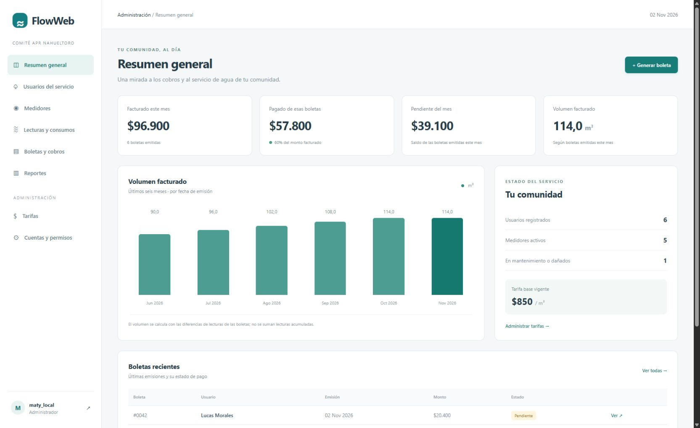
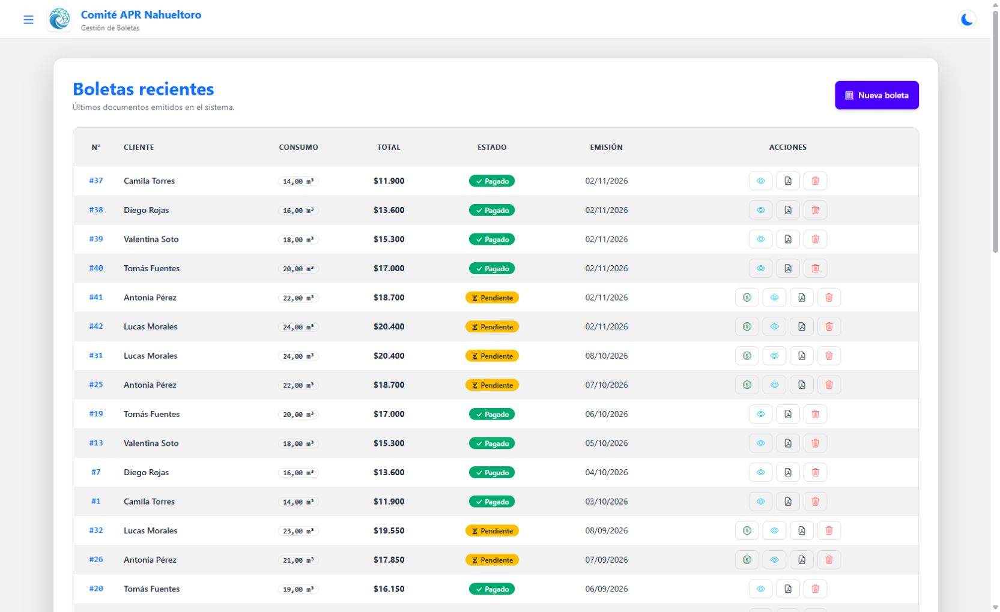
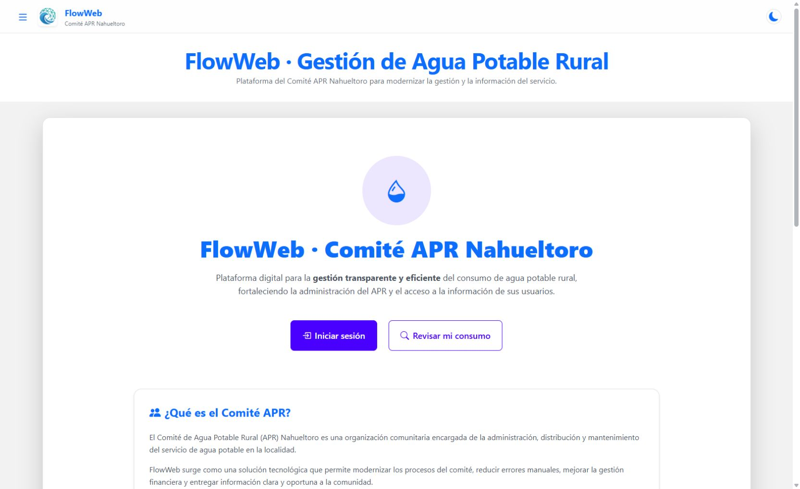
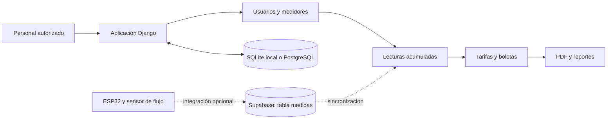

# FlowWeb · Gestión de Agua Potable Rural

**Proyecto de título de Ingeniería en Informática — Matías Muñoz Saavedra.**

FlowWeb reúne la administración de un servicio de Agua Potable Rural (APR) en una aplicación web: usuarios, medidores, lecturas, tarifas, boletas y seguimiento de pagos. El proyecto está contextualizado en el Comité APR Nahueltoro y combina desarrollo web con un prototipo de captura de lecturas mediante ESP32.

Esta versión continúa mi proyecto de título como parte de mi portafolio profesional, con mejoras en presentación, validaciones, pruebas y documentación. Su propósito es mostrar cómo un problema operativo se traduce en modelos de datos, reglas de negocio y flujos de una aplicación.

[Funcionalidades](#funcionalidades) · [Capturas](#capturas-de-la-aplicación) · [Arquitectura](#arquitectura) · [Ejecutar localmente](#ejecutar-localmente) · [Autor y procedencia](#autor-y-procedencia)



## El problema que aborda

La gestión de un APR requiere relacionar las lecturas de cada medidor con el usuario del servicio, aplicar tarifas, emitir documentos de cobro y consultar los montos pendientes. FlowWeb organiza ese recorrido y separa el acceso de los funcionarios de la consulta pública del servicio.

El alcance desarrollado cubre el registro administrativo y la visualización de información. No se afirma una puesta en producción en el comité ni una integración con recaudación bancaria.

## Funcionalidades

| Módulo | Qué permite hacer |
| --- | --- |
| Cuentas y roles | Iniciar sesión y acceder a paneles según el rol de administrador, secretaría u operario. |
| Usuarios del servicio | Registrar y administrar datos de usuarios, con validación de nombre, RUT y formato telefónico. Son registros distintos de las cuentas de acceso. |
| Medidores | Asignar medidores, identificar equipos por número de serie y gestionar sus estados. |
| Lecturas y consumos | Registrar lecturas acumuladas y consultar su historial, con validaciones de coherencia. |
| Tarifas | Configurar tarifas y consultar su historial de vigencia. |
| Boletas | Seleccionar lecturas, calcular cobros, consultar documentos y generar archivos PDF. |
| Panel administrativo | Consultar facturación del mes, montos pagados y pendientes, volumen facturado, tendencia de seis meses y estado del servicio. |
| Reportes y consulta | Revisar información de pagos, deuda y consumo; ofrecer una consulta pública de antecedentes del servicio. |
| Prototipo IoT | Enviar lecturas de un ESP32 a Supabase y sincronizarlas con el módulo de consumos cuando se configura la infraestructura externa. |

### Reglas e indicadores

- Una boleta valida que las lecturas correspondan al mismo usuario y medidor, estén ordenadas por fecha y no disminuyan el contador.
- El volumen facturado se calcula a partir del consumo guardado en las boletas, sin sumar lecturas acumuladas como si fueran consumos independientes.
- La tendencia distingue mes y año e incluye meses sin facturación con valor cero.
- El monto pagado del mes corresponde al estado actual de las boletas emitidas en ese mes. No equivale a ingresos de caja por fecha de pago.

## Capturas de la aplicación

Capturas de la aplicación ejecutándose localmente con **datos ficticios de demostración**. Las cifras y los nombres no corresponden a registros operativos del comité. El panel administrativo tiene un diseño renovado; los otros módulos conservan el diseño del proyecto de título mientras continúa su evolución.

### Historial de boletas

Listado de documentos con usuario, volumen, monto, fecha de emisión y estado de pago, además de accesos a visualización y PDF.



### Portada del servicio

Entrada pública a la plataforma, con acceso al inicio de sesión del personal y a la consulta de consumo.



## Tecnologías

| Área | Implementación |
| --- | --- |
| Backend | Python, Django 4.2 y ORM de Django. |
| Datos | PostgreSQL/Supabase en la integración original; SQLite como alternativa local para explorar la aplicación. |
| Frontend | Plantillas de Django, HTML, JavaScript, Tailwind CSS y Bootstrap en los módulos originales; CSS local en el panel administrativo renovado. |
| Visualización | Chart.js en reportes originales y gráfico con HTML/CSS en el nuevo panel. |
| Documentos | Generación de PDF mediante xhtml2pdf. |
| IoT | ESP32, sensor de flujo YF-S201, reloj DS3231 y envío HTTP a Supabase. |
| Control de versiones | Git y GitHub. |

## Arquitectura

Monolito modular Django con renderizado en servidor. Cada aplicación agrupa modelos, vistas, formularios y plantillas de un área funcional.



Los modelos relacionan usuarios del servicio, medidores, consumos, tarifas y boletas. Las cuentas de acceso se implementan con un modelo de usuario personalizado. El cálculo del contexto del panel está separado en `roles/dashboard.py`.

Consulta las [decisiones de arquitectura y alcance](docs/architecture.md) para conocer las definiciones de indicadores, los límites de la demo y las próximas etapas.

## Ejecutar localmente

### Requisitos

- Python 3.11 o 3.12 y Git. La revisión local de esta versión se realizó con Python 3.12.
- Acceso a internet para instalar dependencias y cargar los recursos CDN de los módulos originales.
- No hace falta configurar Supabase ni conectar un ESP32 para explorar la demo local.

### Instalación en Windows PowerShell

```powershell
git clone https://github.com/Matias-dev-cl/gestion-cobros.git
cd gestion-cobros
python -m venv .venv
.\.venv\Scripts\Activate.ps1
python -m pip install -r requirements.txt

$env:DJANGO_SECRET_KEY = (python -c "import secrets; print(secrets.token_urlsafe(50))")
$env:DJANGO_DEBUG = "True"

python manage.py migrate
python manage.py createsuperuser --username admin
python manage.py shell -c "from registro_cuentas.models import Cuenta; Cuenta.objects.filter(username='admin').update(rol='admin')"
python manage.py seed_demo
python manage.py runserver
```

Abrir **http://127.0.0.1:8000/** e iniciar sesión con el usuario `admin` y la contraseña elegida durante `createsuperuser`. El rol `admin` del proyecto permite acceder al panel funcional; es distinto del atributo de superusuario de Django.

### Recorrido sugerido

1. Entrar al resumen administrativo y revisar los indicadores y la tendencia de seis meses.
2. Explorar los usuarios ficticios y los medidores identificados como `DEMO-`.
3. Abrir el historial de boletas y distinguir documentos pagados y pendientes.
4. Consultar tarifas y reportes para entender cómo se relacionan los módulos.

`seed_demo` solo está disponible con `DEBUG=True`. No crea contraseñas compartidas y se puede repetir sin duplicar los registros correspondientes a los mismos usuarios y fechas. Las boletas de muestra contienen totales preparados, sin lecturas asociadas: sirven para explorar la interfaz y no sustituyen una prueba completa del flujo de medición y cobro.

### Configuración de datos

Sin `DB_HOST`, la aplicación usa SQLite. Para PostgreSQL, exportar `DB_HOST`, `DB_NAME`, `DB_USER`, `DB_PASSWORD` y `DB_PORT`. El archivo [`.env.example`](.env.example) documenta las variables disponibles; Django no lo carga automáticamente. Mantener las credenciales fuera del repositorio.

### Comprobaciones

```powershell
python manage.py check
python manage.py test
```

La suite actual incluye siete pruebas: autenticación, acceso al panel según el rol, indicadores con y sin datos, separación de meses/años y validación de lecturas para boletas. Las capturas documentan la apariencia de la aplicación, no una certificación de todos sus flujos.

## Integración IoT

[`Codigo_Esp32.txt`](Codigo_Esp32.txt) contiene el firmware del prototipo. Es necesario configurar localmente Wi-Fi, URL de Supabase y credenciales, y preparar la tabla externa `medidas`. El modelo `MedidaRaw` representa esa tabla; las migraciones no la crean.

Esta versión conserva el código de integración, pero la revisión del portafolio no incluyó pruebas con hardware ni conexión a un servicio Supabase real.

## Estado y siguientes mejoras

Proyecto de título en evolución hacia un portafolio demostrable. El entorno local permite explorar la aplicación; no se presenta como un servicio de facturación certificado ni listo para producción.

- Extender el diseño del panel a formularios y módulos administrativos.
- Formalizar las reglas tarifarias y reforzar la prevención de cobros duplicados.
- Sustituir la simulación de pagos por una demo que no solicite datos de tarjeta.
- Revisar permisos, privacidad de la consulta pública y dependencias antes de desplegar una demo pública.
- Ampliar pruebas de integración y recorridos completos.

## Autor y procedencia

**Matías Muñoz Saavedra — Ingeniería en Informática, INACAP.**

FlowWeb nació como mi **proyecto de título**. La versión original está en [MattyC4/gestion_cobros](https://github.com/MattyC4/gestion_cobros), otra cuenta de GitHub que también me pertenece. Este repositorio continúa ese mismo proyecto en mi cuenta profesional [Matias-dev-cl](https://github.com/Matias-dev-cl), incorporando documentación, configuración local y mejoras de interfaz y lógica.

El repositorio original se mantiene como referencia de la etapa académica; esta versión reúne la evolución destinada al portafolio profesional.
